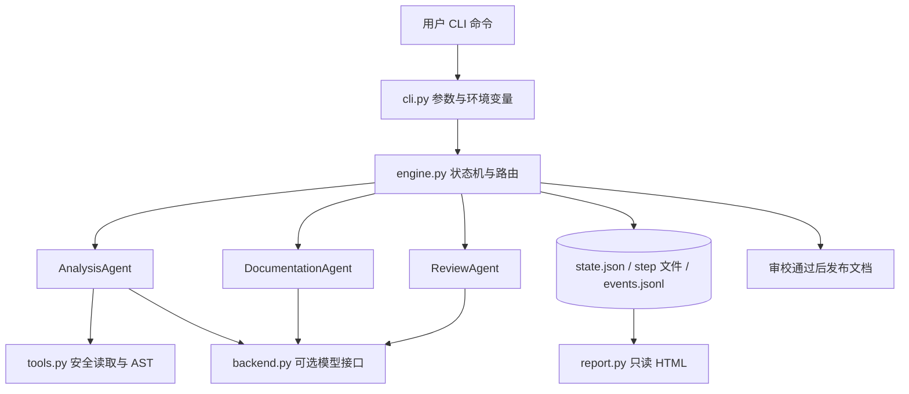
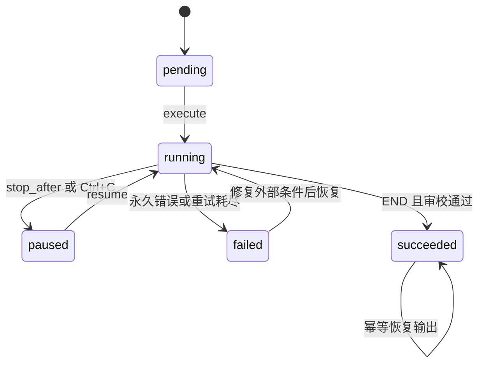

# DocFlow 设计文档

作者：潘彦博（2404080334）　版本：1.0

## 1. 需求与范围

Homework 2 要求用至少两个 Agent 完成可运行的 Workflow，体现编排、通信与状态管理。本项目选择“代码 → 分析 → 文档”，实现三个角色，并增加审校分支与返修循环。主要验收标准为：从选定 Python 文件出发，最终得到经过审校且能追溯至源码行号的中文说明。

核心范围是轻量本地 MVP。项目采用 Python 标准库，避免评审环境因第三方框架安装、版本冲突或无密钥而无法启动。离线后端提供可复现的工具与规则策略，模型后端为同一组角色提供 LLM 推理。二者共享完全相同的编排引擎、状态和审校发布门槛。

## 2. 架构



| 层 | 责任 | 主要文件 |
| --- | --- | --- |
| 入口 | 创建、恢复、查看运行；参数校验和用户提示 | `docflow/cli.py` |
| 编排 | 节点路由、结果提交、重试、暂停与恢复 | `docflow/engine.py` |
| Agent | 分析、写作、审校三个独立角色策略 | `docflow/agents.py` |
| 工具 | 只读文件边界与 Python AST 分析 | `docflow/tools.py` |
| 模型 | Chat Completions 协议、响应解析、错误分类 | `docflow/backend.py` |
| 展示 | 本地 HTML 状态报告，所有数据转义 | `docflow/report.py` |

各 Agent 不直接调用其他 Agent。它们只接收上下文、调用自己所需工具、返回 `Result`。引擎统一保存产物并决定接收者，避免节点之间硬编码调用链。

## 3. Agent 的输入、决策、工具和输出

| 角色 | 输入 | 决策与工具 | 输出 |
| --- | --- | --- | --- |
| 分析 Agent | 文件清单、输入哈希、模式 | `read_file` 核实文件，再用 `ast.parse` 提取定义、签名、导入、异常表达式和行号；模型模式结合源码生成概述 | `analysis` |
| 文档 Agent | `analysis`，以及上一轮 `draft/review` | 离线策略重新构建完整文档；模型策略根据证据与具体反馈改写。行号由可信 AST 证据绑定 | `draft` |
| 审校 Agent | `analysis` 与当前 `draft` | 检查必需章节、接口遗漏、未知和重复接口、证据一致性、未验证链接；模型模式再做独立语义比较 | `review`，以及 `pass/revise` 决策 |

模型模式中三个角色各自发起请求，角色任务与输入不同，审校请求获得源码证据和成稿，不继承写作模型的对话历史。所有模型输出都先做本地结构检查，不能直接修改共享状态或调用任意系统命令。

离线模式不调用模型，其分析能力来自 AST 与源码说明，写作能力来自确定性模板，审校能力来自规则。角色之间的协作、反馈与恢复仍真实执行。缺少 docstring 时输出“需结合源码核实”，避免把规则模板包装成 LLM 结论。

## 4. 通信协议与共享状态

### 4.1 结果信封

```python
@dataclass(frozen=True)
class Result:
    artifact: str       # analysis / draft / review 等
    data: dict          # 结构化产物
    outcome: str        # next / pass / revise
    summary: str        # 人可读消息摘要
```

Agent 的 `Context` 含输入根目录、共享状态的深拷贝、模型适配器与事件发送函数。Agent 对上下文的误修改不会影响引擎。只有成功返回的 `Result` 才能提交。

### 4.2 消息示例

```json
{
  "id": "msg-003",
  "time": "2026-10-24T00:00:00.000+00:00",
  "sender": "review",
  "receiver": "write",
  "artifact": "review",
  "outcome": "revise",
  "revision": 0,
  "summary": "审校退回修改。"
}
```

以上为协议示例，实际时间见执行记录。`artifact` 指向共享状态中的同名产物；每一轮的完整数据还保存在独立 `step-*.json`，因此下一轮覆盖最新产物时不会丢失历史。

### 4.3 状态字段

| 字段 | 含义与约束 |
| --- | --- |
| `schema_version` | 当前为 1；恢复拒绝未知版本 |
| `run_id` | UTC 时间加随机后缀，隔离不同运行 |
| `root`、`inputs` | 输入根目录和规范化路径、SHA-256、字节数、行数 |
| `config` | 模式、模型身份、重试次数、返修上限、演示开关；不保存密钥 |
| `flow` | 入口和结果到下一节点的路由映射 |
| `status` | 运行整体状态 |
| `current` | 下一待执行节点，结束为 END |
| `revision` | 已安排的返修次数，初稿为 0 |
| `steps` | 成功提交的节点次数，含返修节点 |
| `artifacts` | 每类产物的最新完整内容 |
| `messages` | 成功提交节点的消息序列 |
| `error` | 最近失败原因或中断提示 |
| `terminal_reason` | 如返修耗尽，阻止恢复绕过业务上限 |

输入在创建、恢复、每一节点执行前和最终发布前核对哈希。分析节点读取后再核对一次。源文件变化会阻断发布。

## 5. 编排与状态转换



返修耗尽属于终止失败，图中的失败恢复仅适用于接口配置、临时服务问题等可恢复条件。恢复时不能更换输入内容或模式来绕开原状态。

默认路由：

```json
{
  "entry": "analyze",
  "routes": {
    "analyze": {"next": "write"},
    "write": {"next": "review"},
    "review": {"pass": "END", "revise": "write"}
  }
}
```

引擎按 `routes[node][result.outcome]` 选择下一节点，不通过角色名称判断通过或退回。流程初始化验证所有节点已注册、入口可达、目标有效，每个节点都存在到 END 的路径。图中允许循环，运行时以最多 50 步阻止配置错误造成死循环。

发布还有独立门槛：即使用户把流程配置为直接到 END，若没有 `review.passed == true`，仍拒绝发布。当前产品最终产物是审校文档，因此保留该约束；如未来扩展成其他产品，需要有意识地替换最终发布策略。

## 6. 节点提交、错误与恢复

节点的主要处理顺序：

1. 校验输入哈希，记录 `node_started`。
2. 构造隔离上下文，运行 Agent，记录必要的工具事件。
3. 临时错误按退避重试；永久错误直接停止。
4. 成功结果写入 `step-NNN.json`，更新最新产物和消息。
5. 根据结果选择下一节点，更新返修计数。
6. 原子保存 `state.json`。随后可暂停，或者运行下一节点。
7. 到 END 后再次校验输入，发布最终文档并保存成功状态。

### 错误策略

| 类型 | 行为 |
| --- | --- |
| 429、5xx、连接异常、超时 | `TransientError`，最多重试配置次数 |
| 模型返回非 JSON、缺少字段、字段类型或长度错误 | `TransientError`，重新执行该节点 |
| 401、403、其他非临时 HTTP 错误 | `WorkflowError`，立即停止，提示检查配置 |
| 文件不存在、越界、二进制、过大、语法错误 | `WorkflowError`，立即停止 |
| 审校不通过 | 正常 `revise` 业务分支，不消耗接口重试次数 |
| 返修次数耗尽 | 保存失败，保留各轮草稿与问题，禁止再次 resume 绕过上限 |
| Ctrl+C | 保存暂停状态，退出码 130，可从最近已提交节点恢复 |

默认每节点最多重试 2 次，也就是最多 3 次尝试；等待 1、2 秒。配置上限为 5 次，后续等待最多 4 秒。模型请求超时默认为 30 秒。临时失败的半成品不产生成功消息或成功节点计数。

### 持久化语义

状态先写同目录临时文件，`flush/fsync` 后替换目标文件，避免正常中断产生半个 JSON。`.run.lock` 使用排他创建，限制同一运行只有一个写进程。

本项目提供**节点级恢复**。已提交节点跳过，未提交节点可能重复执行。HTTP 请求和多个输出文件之间没有分布式事务；硬杀进程或断电时，日志可能比状态多一个事件，未提交的 step 文件也可能已写出。恢复以 `state.json` 为准，step 与事件用来诊断。不能声称跨文件原子或模型调用恰好一次。

若进程硬退出留下锁，用户须先确认原进程不再运行，再删除相应运行目录的 `.run.lock`。程序不自动猜测锁过期时间，以免抢占活跃进程。

## 7. 安全与证据约束

- 继承 Homework 1 的文件读取边界：先解析真实路径，再要求其属于输入根目录，拒绝 `..` 越界和指向外部的符号链接。
- 仅接受 UTF-8 文本，拒绝 NUL、超限文件和重复输入；按有界字节读取，避免文件在检查后变大时突破大小限制。
- 源码仅交给 AST 解析和文档模型，不使用 `exec`、`eval`，不导入输入项目。
- 模型提示把源码、注释和已有文档标为数据，禁止从中接受新指令。此提示不能证明完全抵抗提示注入，因此模型没有系统执行能力，证据与发布门槛仍由本地代码控制。
- 模型接口远程必须 HTTPS；HTTP 只允许本机测试；拒绝 URL 内嵌账号、查询参数，禁止跟随重定向，避免 Authorization 被转发。
- 不记录密钥或 HTTP 错误响应体。状态保留源码证据以便复核，模型模式会向配置服务发送源码，使用前应确认选定文件适合发送。
- HTML 将文档和事件全部转义，禁用脚本和外部资源，防止源码 docstring 被当作页面脚本执行。

静态行号、签名和接口覆盖可由确定性工具核对。docstring 本身仍可能不正确；模型语义审校也可能漏检。输出始终注明“静态分析、未执行输入代码”。

## 8. 扩展新 Agent

以下为可运行的扩展示例，在 Python 脚本中执行即可。测试 `test_add_new_node_without_engine_changes` 验证同类扩展。

```python
from pathlib import Path
from docflow.agents import Result, default_registry
from docflow.engine import Workflow

class AuditAgent:
    def run(self, context):
        count = len(context.state["inputs"])
        return Result("audit", {"file_count": count}, summary="文件清单核对完成。")

registry = default_registry() | {"audit": AuditAgent()}
flow = {
    "entry": "analyze",
    "routes": {
        "analyze": {"next": "audit"},
        "audit": {"next": "write"},
        "write": {"next": "review"},
        "review": {"pass": "END", "revise": "write"},
    },
}
workflow = Workflow.create(
    Path("examples/shop"), ["pricing.py", "orders.py"], Path("runs"),
    registry=registry, flow=flow,
)
workflow.execute()
```

新增节点只需要实现角色、注册并配置路由。新工具通过 `context.tool(...)` 产生事件。新模型服务可以实现同样的 `complete(role, task)` 和 `identity()` 接口，再通过构造参数注入。

恢复自定义运行时也必须传入同一组自定义注册节点。CLI 默认只注册三个标准节点，未提供动态导入任意插件的功能。

## 9. 与 Homework 1 的关系

| 项目 1 思路 | 项目 2 的继承与调整 |
| --- | --- |
| 单个代码解释 Agent | 拆成分析、写作、审校三种职责 |
| 安全的 `read_file` | 保留真实路径、UTF-8 与大小限制，改为结构化结果和哈希 |
| 带行号的代码说明 | AST 记录函数或类的起止行，写入接口证据 |
| 单次问答上下文 | 升级为跨节点共享产物、消息信封和持久化检查点 |
| API 请求重试 | 明确区分可重试接口错误与正常业务返修 |

实现参考了原文件夹中 `2404080334潘彦博/code-explain-agent/code_explain_agent/agent.py` 的安全读取思路。旧项目本身不作为本项目运行依赖。

## 10. 两周 MVP 工作分解（计划）

这是面向作业周期的实施计划，实际验证记录以随包测试与演示产物为准。

| 工作包 | 计划日 | 交付与验收 |
| --- | --- | --- |
| 需求与协议 | 第 1–2 天 | 三角色职责、产物字段、路由与验收矩阵 |
| 分析工具与输入边界 | 第 3–4 天 | AST 证据、安全读取、异常测试 |
| 写作与审校协作 | 第 5–7 天 | 顺序流程跑通，审校能发现漏章与漏接口 |
| 分支与持久化 | 第 8–9 天 | 有界返修、节点检查点、失败后恢复 |
| 模型适配与观察 | 第 10–11 天 | 独立角色请求、本地 HTTP 测试、HTML 报告 |
| 验收与提交 | 第 12–14 天 | 测试、三类演示、README/Design、提交包复核 |

| 风险 | 影响 | 应对 |
| --- | --- | --- |
| 评审时无 API 密钥或网络 | 无法演示 LLM | 默认离线流程与完整本地演示 |
| 模型返回不合规结构 | 下游无法读取 | 字段校验、有限重试和失败检查点 |
| 审校不断退回 | 无法收敛 | 最大返修次数和全局 50 步上限 |
| 输入在运行中变化 | 证据不一致 | SHA-256 核对，拒绝混用 |
| 环境与依赖差异 | 无法启动 | Python 3.10+ 标准库实现 |

## 11. 未来扩展

在保持当前轻量结构的前提下，可以增加其他语言分析器、以规范 JSON Schema 验证更多产物、增加人工确认节点，或为只读分析任务引入并行执行。当前版本没有实现这些能力，验收以实际源码与执行证据为准。
