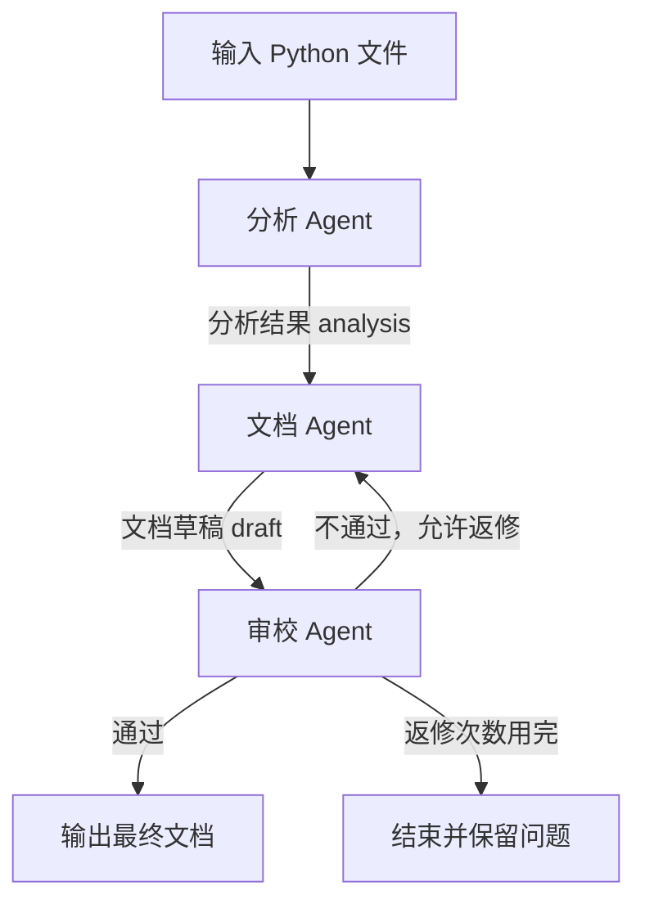

# 设计文档

作者：潘彦博（2404080334）

## 1. 项目目标

上次作业做的是单个代码解释 Agent。这次我选择文档生成方向，把读取分析、编写文档和检查文档拆成三个 Agent，重点实现它们之间的数据传递和流程控制。

输入为项目中的 Python 文件，输出为带源码行号的中文说明。主流程先顺序执行，审校发现问题时再返回文档节点。为了方便复现，保留了不需要密钥的离线模式，也提供了模型接口。

## 2. 流程图



如果 Markdown 查看器不能显示 Mermaid，可以按下面的文字流程查看：

```text
输入文件 → 分析 → 生成文档 → 审校 → 输出
                         ↑       |
                         └─ 不通过┘
```

正常流程执行三个节点。返修演示中，初稿漏掉“验证建议”，第一次审校不通过，修改后再次审校，总共执行五次节点。

## 3. 整体架构

```text
命令行 cli.py
    ↓
工作流引擎 engine.py
    ├── AnalysisAgent：读取文件、分析代码
    ├── DocumentationAgent：生成或修改文档
    └── ReviewAgent：检查文档、返回通过或修改意见
    ↓
state.json、step 文件、events.jsonl
    ↓
最终 Markdown 文档与 HTML 报告
```

`agents.py` 实现三个角色，`tools.py` 提供文件读取和 AST 分析，`backend.py` 负责可选的模型请求，`report.py` 生成本地报告。

`main.py` 提供菜单入口，可以直接选择正常运行、返修、暂停恢复或自选文件。它复用同一个引擎，参数较多时仍可以使用 `python -m docflow`。

我把调度放在引擎中，各个 Agent 只处理自己的输入并返回结果。这样修改流程时，不需要在一个 Agent 中改另一个 Agent 的调用代码。

## 4. 三个 Agent 的分工

| Agent | 接收什么 | 做什么 | 返回什么 |
| --- | --- | --- | --- |
| 分析 Agent | 文件路径和输入哈希 | 安全读取文件，用 AST 提取函数、类、签名、导入和行号；模型模式下再生成概述 | `analysis` |
| 文档 Agent | 分析结果、上一版草稿和审校意见 | 生成文档，返修时根据问题重新编写 | `draft` |
| 审校 Agent | 分析结果和当前草稿 | 核对章节、接口覆盖、重复接口和源码位置；模型模式下再检查解释内容 | `review`，以及 `pass` 或 `revise` |

例如，分析 `pricing.py` 后，`total_price` 的记录中包含接口 ID `pricing.py::total_price`、函数签名、docstring 和第 6–17 行的位置。文档 Agent 使用这份结果编写说明，审校 Agent 再把草稿中的接口清单与分析结果比较，检查有没有遗漏。

离线模式使用规则和模板，模型模式则由三个角色分别请求模型。审校请求会重新提供源码和草稿，不沿用写作 Agent 的对话。

## 5. Agent 之间怎么传递数据

每个 Agent 都实现 `run(context)`，并返回统一的结果：

```python
@dataclass(frozen=True)
class Result:
    artifact: str       # 结果名称，例如 analysis
    data: dict          # 具体内容
    outcome: str        # next、pass 或 revise
    summary: str        # 简短说明
```

引擎将 `data` 保存到共享状态的 `artifacts`，再根据 `outcome` 决定下一个节点。消息记录中保存发送者、接收者和结果名称。

返修时的一条消息如下，省略了时间字段：

```json
{
  "id": "msg-003",
  "sender": "review",
  "receiver": "write",
  "artifact": "review",
  "outcome": "revise",
  "revision": 0,
  "summary": "审校退回修改。"
}
```

具体问题保存在 `artifacts.review.issues` 中。演示里的问题是“缺少章节：验证建议”，文档 Agent 运行时会同时拿到这份意见和上一版草稿。

给 Agent 的状态是深拷贝，防止某个节点直接改坏共享状态。只有节点成功返回后，引擎才保存它的结果。每轮结果还单独保存在 `step-*.json` 中，后续修改不会覆盖旧版本。

报告会按消息顺序读取这些 step 文件，在“每一步的结果”中分别显示。即使最终审校已经通过，也可以展开第一轮审校，查看当时的问题和对应草稿。

## 6. 状态管理和恢复

主要状态字段如下：

| 字段 | 作用 |
| --- | --- |
| `run_id` | 区分每次运行 |
| `inputs` | 输入文件、字节数、行数与 SHA-256 |
| `current` | 下一步要执行的节点 |
| `status` | pending、running、paused、failed 或 succeeded |
| `artifacts` | 各 Agent 最新的分析、草稿和审校结果 |
| `messages` | 节点之间的消息记录 |
| `steps`、`revision` | 已完成节点数和返修次数 |
| `config`、`flow` | 运行参数和流程配置 |
| `error` | 最近的错误信息 |

每个节点完成后，程序先保存结果，再更新下一节点并写入 `state.json`。状态文件通过“写临时文件再替换”的方式保存，减少中断时留下半个 JSON 的情况。恢复以状态文件为准，已完成的节点跳过，没保存完成的节点重新执行。

例如，在分析后暂停时，状态为 `paused`，`current` 为 `write`，`steps` 为 1。恢复后从文档 Agent 开始，最后累计三个节点。恢复前还会核对文件哈希，源码改变时要求重新运行。

同一运行使用 `.run.lock` 限制同时写入。当前实现适用于本地单进程，日志和状态之间没有跨文件事务，强制结束时可能重复执行尚未提交的节点，模型请求也可能重复发送。

## 7. 流程配置与扩展

默认配置为：

```json
{
  "entry": "analyze",
  "routes": {
    "analyze": {"next": "write"},
    "write": {"next": "review"},
    "review": {"pass": "END", "revise": "write"}
  }
}
```

引擎根据 `routes[当前节点][结果]` 查找下一步，所以分支由配置控制。加载配置时会检查节点是否注册、目标是否存在，以及节点是否能从入口到达、是否有到 END 的路径。运行时最多执行 50 步，防止循环无法结束。

增加 Agent 分为三步：

1. 实现 `run(context)` 并返回 `Result`。
2. 将实例加入注册表，例如 `registry["audit"] = AuditAgent()`。
3. 在流程中增加路由，例如把 `analyze → write` 改成 `analyze → audit → write`。

[scripts/extend_demo.py](scripts/extend_demo.py) 提供了完整例子。新增的 `AuditAgent` 检查分析结果是否覆盖输入文件，并返回文件数和接口数。运行 `python scripts/extend_demo.py`，会使用 [扩展配置](examples/extended_flow.json) 执行四节点流程，不需要修改引擎。

这个四节点流程只用于检查扩展能力，平时运行的仍是三 Agent 流程。恢复自定义流程时，也需要传入相同的注册表。

## 8. 异常处理

文件越界、语法错误、接口权限错误等问题会直接停止。连接超时、HTTP 429、5xx 或模型 JSON 不合要求时，会重试当前节点。默认最多重试两次，间隔为 1、2 秒。

审校不通过属于正常业务分支，不算接口错误。默认最多返修两次，超过次数后保留草稿和意见，不生成最终文档。到 END 时还会检查审校是否通过，避免错误配置跳过检查。

Ctrl+C 会保存暂停状态，退出码为 130。其他失败会记录原因，修正问题后可以从最近的检查点恢复；返修次数用完的运行需要重新创建。

## 9. 文件读取和模型调用

文件读取沿用了 Homework 1 的思路：解析真实路径后确认文件位于根目录内，只读取 UTF-8 文本，并限制大小。AST 只解析结构，不导入或执行输入项目。公开接口中包含类和方法，保留 `__init__`，不展开函数内部的局部定义；同作用域的重名公开定义暂不做覆盖推断。

源码、docstring 和草稿在模型提示中都作为待分析内容。模型没有执行命令的工具，返回的行号和接口覆盖还要经过本地检查。报告会转义文档内容，防止源码里的 HTML 被当作脚本运行。

模型密钥从环境变量读取，不写入状态文件。远程接口要求 HTTPS，不跟随重定向。模型接口目前通过本地模拟服务验证，云端模型的实际效果还需要配置账号后检查。

## 10. 测试和不足

目前共有 44 项自动测试，43 项通过，1 项由于 Windows 符号链接权限不足跳过。正常、返修和暂停恢复三组示例都能完成。测试和运行结果见 [测试报告](docs/测试报告.md)。

目前的主要不足是只支持 Python 静态分析，没有并行调度，也不能证明生成的每一句说明都正确。后续可以增加其他语言的分析工具，或加入人工确认节点。现阶段先保证完整流程、数据传递和恢复机制能清楚地运行和查看。
