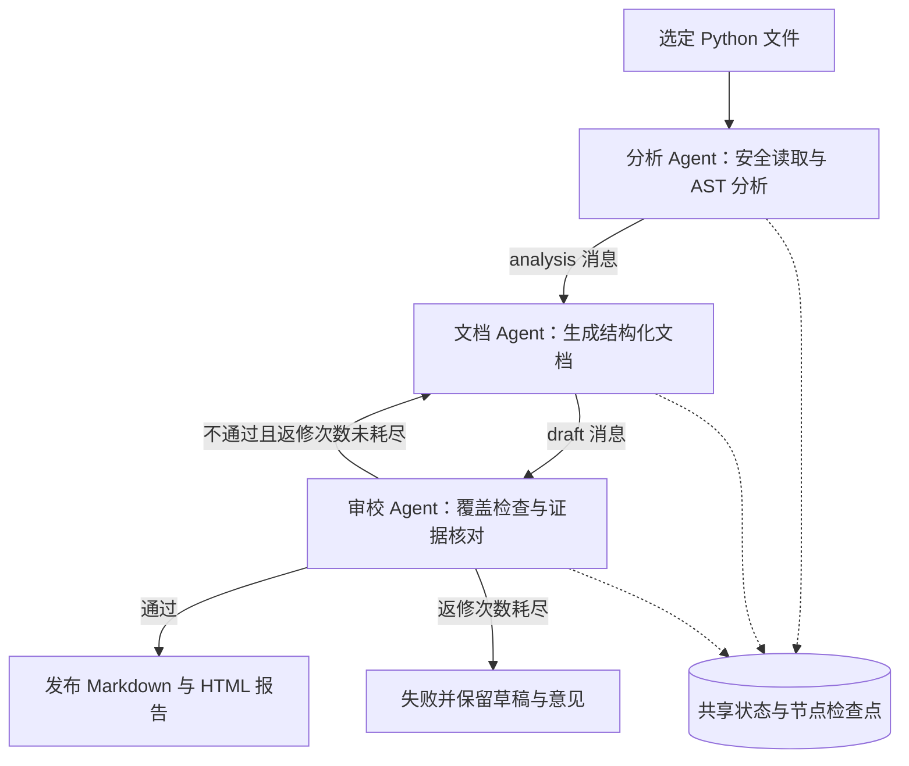

# DocFlow：多 Agent 代码文档工作流

软件项目管理课程 · Homework 2 · Simple Workflow MVP  
作者：潘彦博　学号：2404080334

DocFlow 接收一个 Python 项目中明确选定的文件，依次调用**代码分析 Agent、文档生成 Agent、审校 Agent**，输出带源码行号的中文说明文档。审校发现遗漏时，工作流把问题传回文档 Agent，修改后重新审校。每一步都有消息、产物与检查点，可查看执行过程，也可暂停后恢复。

本项目选择作业中的“文档生成流程”，在分析和文档两个节点之外增加独立审校节点，延续 Homework 1 的代码解释方向与目录内安全读取工具设计。

## 1. 三分钟运行

需要 **Python 3.10 或更高版本**。离线和模型模式均只使用 Python 标准库，不需要安装第三方包。

解压提交包，在 `docflow-workflow` 文件夹打开 PowerShell（当前源码目录为 `Homework2`）。执行：

```powershell
python --version
python -m docflow run --root examples/shop --files pricing.py orders.py
```

程序显示运行目录，形如 `runs/20261024TxxxxxxZ-xxxxxxxx/`，每次运行使用独立目录。正常运行结果应为：

```text
[node_started] analyze: 执行 analyze
[node_succeeded] analyze: 代码结构和源码证据已发送给文档 Agent。
[node_started] write: 执行 write
[node_succeeded] write: 文档第 1 版已发送审校。
[node_started] review: 执行 review
[node_succeeded] review: 审校通过。
结果：succeeded；已提交 3 个节点；返修 0 次。
```

打开程序显示的 `report.html` 可查看状态、协作消息、文档和原始事件，无需启动网页服务。

PowerShell 可自动打开最近生成的报告：

```powershell
$latestRun = Get-ChildItem runs -Directory | Sort-Object LastWriteTime -Descending | Select-Object -First 1
Invoke-Item (Join-Path $latestRun.FullName 'report.html')
```

或者直接打开随包提供的 [完整返修演示报告](docs/evidence/revision/report.html)。

一分钟内了解项目，可播放 [54 秒演示视频](docs/演示视频.mp4)（中文讲解字幕，无旁白，基于真实执行产物）。

## 2. 工作流与三种演示



### A. 正常顺序流程

```powershell
python -m docflow run --root examples/shop --files pricing.py orders.py
```

预期：`analyze → write → review → END`，3 个节点，0 次返修。

### B. 审校分支与有界返修

```powershell
python -m docflow run --root examples/shop --files pricing.py orders.py --demo-revision
```

预期：`analyze → write → review → write → review → END`，5 个节点，1 次返修。

`--demo-revision` 是**显式故障注入开关**：初稿主动遗漏“验证建议”，审校 Agent 用统一规则发现缺章，生成 `revise` 消息，第二版补齐后通过。正常模式不主动制造遗漏。演示中的退回、反馈和第二次审校都是真实执行，第一版与第二版均保留在 `step-*.json` 中。

默认最多返修 2 次；`--max-revisions 0` 表示不允许返修。超过上限会失败，不会把草稿发布为最终文档。此类失败必须调整配置后新建运行。

### C. 节点检查点与恢复

```powershell
python -m docflow run --root examples/shop --files pricing.py orders.py --stop-after analyze
$pausedRun = Get-ChildItem runs -Directory | Sort-Object LastWriteTime -Descending | Select-Object -First 1
python -m docflow inspect $pausedRun.FullName
python -m docflow resume $pausedRun.FullName
```

第一次执行后显示 `status=paused current=write steps=1`。恢复后只执行文档与审校，最终累计 3 个节点。已经完成的分析节点不会再执行。

项目搬到其他位置时，可以明确提供新的输入根目录：

```powershell
python -m docflow resume $pausedRun.FullName --root examples/shop
```

恢复时逐文件核对 SHA-256。输入发生变化时拒绝恢复，应重新 `run`。程序不会混用旧分析与新源码。

也可运行 `python scripts/demo.py`，一次生成以上三类演示，并验证预期节点数。

## 3. 两种执行模式

| 模式 | 机制 | 网络与密钥 | 适合场景 |
| --- | --- | --- | --- |
| `offline`（默认） | 三个独立角色以 AST、规则和模板决策，真实执行状态流转与工具调用 | 完全无需联网和密钥 | 教师快速验收、稳定复现、流程与边界测试 |
| `llm` | 三个角色分别发起模型请求，使用各自任务提示；AST 与审校规则继续提供确定性约束 | 需要可用接口和账号密钥 | 更丰富的中文代码解释与语义审校 |

离线模式是**规则驱动的协作实现**，不能等同于大模型推理。它会引用源码 docstring，缺少说明时明确提示，不会根据函数名猜测复杂业务语义。模型模式才会调用 LLM 分析代码、生成解释并独立审校。

### 可选模型模式

支持提供 Chat Completions 兼容接口的服务。基址必须包含服务商要求的 API 前缀，例如 OpenAI 官方基址 `https://api.openai.com/v1`，程序会追加 `/chat/completions`。模型名使用账号实际可用且支持文本聊天的名称，不在代码中绑定某个模型。

```powershell
$secureKey = Read-Host '请输入模型 API Key' -AsSecureString
$env:DOCFLOW_API_KEY = [System.Net.NetworkCredential]::new('', $secureKey).Password
$env:DOCFLOW_BASE_URL = 'https://api.openai.com/v1'
$env:DOCFLOW_MODEL = Read-Host '请输入账号可用的模型名'
python -m docflow run --root examples/shop --files pricing.py orders.py --mode llm
```

`DOCFLOW_MODEL` 和 `DOCFLOW_API_KEY` 必填。`.env.example` 仅为字段说明，程序不自动加载 `.env`。同一运行恢复时必须保持接口地址与模型名一致，密钥可更换。

适配器使用 `messages` 与 `model` 发起非流式请求，通过提示要求返回 JSON，并在本地逐字段校验。为兼容不同服务，没有强制发送 `response_format`、温度或特定推理参数。并非所有兼容服务都保证返回正确结构，错误响应会触发有限重试。参考 [Chat Completions 官方接口](https://developers.openai.com/api/reference/resources/chat/subresources/completions/methods/create)。

**验证范围：**本项目已用本地 HTTP 模拟服务测试真实请求格式及三个 Agent 的完整在线代码路径，未使用真实付费账号做外部模型实连。`docs/evidence` 的随包演示全部为离线模式。使用模型模式会将选定文件的源码、docstring 和中间文档发送给所配置的服务。

## 4. 输出与观察方式

| 文件 | 用途 |
| --- | --- |
| `README.generated.md` | 通过审校后的最终中文代码说明 |
| `review.json` | 最终审校结果、问题清单与接口覆盖数量 |
| `report.html` | 本地只读可视化报告，包含协作消息和执行事件 |
| `state.json` | 工作流状态、当前节点、输入哈希、共享产物及消息信封 |
| `events.jsonl` | 按发生顺序追加的执行与工具事件 |
| `step-001.json` 等 | 每次成功节点的独立结果，保留返修前后版本 |

状态可取 `pending / running / paused / failed / succeeded`。时间戳使用 UTC ISO 8601，运行目录名中的 `Z` 表示 UTC。课程截止时间按北京时间理解。

失败和暂停时可能已有 `draft`，但只有审校通过并到达 END 才会生成最终 Markdown。报告会明确标注草稿。HTML 将外部内容全部转义，并禁止脚本与外部资源加载。

## 5. 测试

```powershell
python -m unittest discover -s tests -v
```

测试无需密钥。覆盖完整协作、真实返修、暂停恢复、失败后恢复、哈希变化、节点重试、返修耗尽、路径越界、UTF-8/二进制/大小限制、AST 定义分析、HTML 转义、扩展节点和模型 HTTP 协议。具体结果见 [测试报告](docs/测试报告.md)。

## 6. 扩展与自定义流程

```powershell
python -m docflow run --root examples/shop --files pricing.py orders.py --flow examples/flow.json
```

JSON 定义入口和各节点的结果路由。新增 Agent 实现 `run(Context) -> Result`，注册后将新节点加入路由即可，不需要修改引擎。完整示例见 [设计文档](Design.md#8-扩展新-agent)。

流程图会检查未知节点、未知目标、不可达节点和无法到达 END 的分支；运行时另有 50 步上限。当前引擎专注顺序执行、条件分支和有界循环，未实现并行调度或拖拽式编排编辑器。

## 7. 目录

```text
docflow-workflow/
├── docflow/              # CLI、三个 Agent、引擎、模型适配、安全工具、报告
├── examples/shop/        # 两个可分析的 Python 文件
├── examples/flow.json    # 可编辑路由配置
├── tests/                # 行为与协议测试
├── docs/evidence/        # 三类真实执行记录与最终文档
├── docs/需求对照.md       # 全部作业要求、评分项与验收方法
├── docs/测试报告.md
├── docs/演示讲稿.md
├── scripts/demo.py       # 重新生成三类演示
├── scripts/package.py    # 源码与演示证据打包
├── README.md
├── Design.md             # 架构、状态、协议、恢复与扩展说明
├── Desgin.md             # 对应作业原文拼写的文档入口
└── requirements.txt      # 标准库项目，无额外依赖
```

## 8. 边界与取舍

- 仅支持明确选定的 Python UTF-8 文件，每文件不超过 32,000 字节、最多 30 个、总计不超过 160,000 字节；不自动遍历整个仓库。
- 只做静态分析，不导入、执行或修改被分析代码；不能判定动态生成的接口、运行时注入、实际测试结果或业务正确性。
- 文档清单包含公开模块定义、公开类及其公开方法，保留 `__init__`，不展开函数内局部定义。同一作用域的重名公开定义会明确拒绝，暂不推断覆盖、重载或属性 setter。
- 单进程本地 MVP，不是分布式系统。锁防止同一运行同时写入；异常退出可能留下 `.run.lock`，须确认没有进程后再手动移除。
- 节点检查点采用同目录临时文件与原子替换。强制断电可能使未提交节点再次执行，模型请求不保证恰好一次。日志与状态不是跨文件事务，状态文件为恢复依据。
- 模型语义审校可能出错。离线规则检查保证本项目定义的结构和证据覆盖，不构成对每一句解释正确性的证明。

## 9. 提交

要求解读与验收入口见 [需求对照](docs/需求对照.md)。项目包含完整源码和 Git 仓库快照，可离线恢复仓库；无需依赖远程仓库权限。提交压缩包按 `2404080334潘彦博.zip` 命名，小于 200 MB。按作业要求上传至 `002Homework2`，截止时间为 **2026 年 10 月 25 日 24 点（北京时间）**。

打包工具使用白名单，只收录源码、文档和演示证据，排除 API 密钥、`.env`、缓存及本地运行目录。首次打包需确保 `docs/evidence` 已由演示脚本生成：

```powershell
python scripts/demo.py
python scripts/package.py
```
